# ICBT CSE5009 Web Application Development
## Task 01: Planning and Design Documentation
**Project:** SwiftDrive Rentals — Full-Stack Web Application  
**Location:** Negombo, Western Province, Sri Lanka  
**Module:** CSE5009 Web Application Development  
**Target Grade Band:** Excellent (70–100%)

---

### 1. Executive Summary & Problem Formulation
SwiftDrive Rentals is a specialist vehicle hire company operating from Lewis Place, Negombo, situated within 15 minutes (8.5 km) of Bandaranaike International Airport (CMB). Sri Lanka's domestic transport and tourist vehicle hire market requires a reliable, transparent, and mobile-responsive digital reservation platform capable of handling:
1. **Self-drive tourists and business travellers** demanding instant airport delivery, clear daily/weekly rates in Sri Lankan Rupees (LKR), and refundable security deposit visibility.
2. **Local family and corporate clients** requiring multi-passenger vans, hybrid sedans, and SUVs.
3. **Operations staff** managing vehicle handovers, vehicle return condition checklists (mileage, fuel level, damages), and overdue booking tracking.
4. **Fleet administrators** managing vehicle inventory, dynamic tariff rates, customer inquiries, and auditing sensitive operational actions.

The primary objective of this project is to eliminate opaque pricing, double-booking conflicts, and manual paper-based handover inspections through an accessible, transaction-safe, full-stack web application.

---

### 2. Website Comparison and Critical Evaluation

To establish industry benchmarks and identify UX pain points, two existing car rental platforms operating in Sri Lanka and internationally were critically evaluated against standardized criteria:
1. **Malkey Rent-A-Car Sri Lanka** (`malkey.lk`) — Leading domestic car rental provider based in Colombo.
2. **Hertz Car Rental** (`hertz.com`) — Global market leader in automated vehicle reservations.

#### 2.1 Standardized Evaluation Criteria
1. **Information Architecture & Discoverability:** Navigation clarity, ease of locating fleet categories, and terms of service.
2. **Search & Availability Engine:** Accuracy of date-based vehicle availability filtering and pickup/drop-off location selection.
3. **Pricing Transparency:** Upfront visibility of total rental cost, weekly discount thresholds, refundable security deposits, and hidden fees.
4. **Mobile Responsiveness & Accessibility:** Touch target sizing, viewport adaptability, WCAG AA color contrast, and form usability.
5. **Operational Integrity & Account Workflow:** Self-service customer booking management, staff handoff tracking, and audit logging.

#### 2.2 Comparative Analysis Matrix

| Evaluation Dimension | Malkey Rent-A-Car (`malkey.lk`) | Hertz Global (`hertz.com`) | SwiftDrive Rentals (Proposed Solution) |
| :--- | :--- | :--- | :--- |
| **Fleet Presentation** | Static tabular listings with small thumbnail imagery. Specifications are fragmented. | High-resolution hero imagery, dynamic vehicle category pills, and rich specification badges. | High-definition card grid, specification badges (Transmission, Fuel, Seats, Luggage, Air Conditioning), and high-res image galleries. |
| **Pricing Transparency** | Rates shown in LKR or USD, but requires an inquiry form or manual staff email quote to calculate deposit and total cost. | Real-time dynamic quotation with taxes and add-ons; occasionally conceals local deposit hold policies until checkout. | **100% Server-Side Instant Quote:** Full breakdown displaying daily rate, duration, weekly prorated discount, security deposit, and net total in LKR before checkout. |
| **Availability Validation** | Static request system. Double-booking prevented solely by human coordinators over telephone/email. | Complex enterprise inventory engine with location-specific availability and instant booking confirmations. | **ACID Transaction-Safe Availability:** Overlapping booking validation via server-side locking; impossible to double-book active vehicle dates. |
| **Mobile Experience** | Desktop-centric layouts with horizontal table scrolling and small tap targets (< 36px) on mobile viewports. | Highly polished mobile web responsive application, optimized thumb zones. | Clean single-column mobile flow, collapsible drawer navigation, minimum 44px tap targets, zero horizontal overflow. |
| **Vehicle Handover Protocol** | Physical printed paper triplicate forms for mileage, scratch marks, and fuel gauge marks. | Handheld tablet app for lot agents, but opaque to customer portal view. | **Digital Vehicle Inspection Modal:** Staff record pickup/return odometer readings, fuel eighths (1/8 to 8/8), and damage logs with instant audit trails. |
| **UI Aesthetics & Visual Tone** | Traditional legacy enterprise styling with dated layout and crowded banners. | Corporate gold/black branding, highly functional but visually dense. | **Minimal, Professional Corporate Palette:** Deep Navy (`#102A43`), Emerald Teal (`#0F766E`), Slate borders (`#E2E8F0`). No distracting neon or AI gradients. |

#### 2.3 Synthesis and Design Opportunity
The comparative evaluation proves that while domestic platforms like Malkey lack real-time pricing and automated availability verification, international platforms like Hertz are overly complex and unsuited for Sri Lankan local contexts (such as Colombo airport curbside delivery, local cash/deposit bank transfer workflows, and LKR currency formatting). SwiftDrive Rentals bridges this gap by marrying international UI/UX standards with localized Sri Lankan business logic.

---

### 3. Information Architecture and Sitemap

The information architecture is partitioned into four distinct access tiers: **Public Visitor**, **Authenticated Customer**, **Operations Staff**, and **System Administrator**.

```mermaid
graph TD
    Root["SwiftDrive Rentals Portal"] --> Public["Public Website"]
    Root --> Customer["Customer Portal (Auth)"]
    Root --> Staff["Staff Operations Portal"]
    Root --> Admin["Administrator Management Portal"]

    Public --> Home["/ (Homepage)"]
    Public --> Catalogue["/catalogue (Fleet Catalogue)"]
    Public --> Details["/vehicles/:id (Vehicle Specifications & Pricing)"]
    Public --> About["/about (About SwiftDrive Negombo)"]
    Public --> Terms["/terms (Rental Terms & Deposit Policies)"]
    Public --> Contact["/contact (Inquiry & Office Location)"]
    Public --> Blog["/blog (Sri Lanka Driving & Road-Trip Guides)"]
    Public --> Login["/login (Authentication)"]
    Public --> Register["/register (Customer Registration)"]

    Customer --> CustDash["/customer (My Reservations & Dashboard)"]
    CustDash --> CustBookings["Booking Details & Status Tracking"]
    CustDash --> CustCancel["Cancellation Request (Policy Protected)"]
    CustDash --> CustProfile["Personal & Driving License Profile"]

    Staff --> StaffDash["/staff (Operations Desk)"]
    StaffDash --> StaffBookingSearch["Reservation Lookup & Filter"]
    StaffDash --> StaffStatusWorkflow["Booking Status Transitions"]
    StaffDash --> StaffInspection["Pickup & Return Condition Reports"]
    StaffDash --> StaffOverdue["Overdue Return Alert Banner"]
    StaffDash --> StaffInquiries["Customer Inquiry Resolution"]

    Admin --> AdminDash["/admin (Executive Fleet Management)"]
    AdminDash --> AdminFleet["Fleet CRUD & Status Management"]
    AdminDash --> AdminUsers["Staff & Customer Role Permissions"]
    AdminDash --> AdminPayments["Payment & Deposit Ledger"]
    AdminDash --> AdminMetrics["Database-Grounded KPI Analytics"]
    AdminDash --> AdminAudit["Tamper-Evident Security Audit Logs"]
```



---

### 4. Detailed Wireframes and Layout Specifications

#### 4.1 Desktop & Mobile Wireframe: Homepage (`/`)
```
+------------------------------------------------------------------------------------+
| [LOGO: SwiftDrive Rentals]    Fleet    About    Terms    Guides    Contact  [Login]    |
+------------------------------------------------------------------------------------+
| HERO SECTION                                                                       |
| "Premium Car Rentals in Negombo & Colombo CMB Airport"                             |
| Transparent LKR pricing, self-drive freedom, and 24/7 airport curbside handover.  |
|                                                                                    |
| +--------------------------------------------------------------------------------+ |
| | SEARCH & AVAILABILITY ENGINE                                                   | |
| | [Pickup Date: 2026-10-20] [Return Date: 2026-10-25] [Category: All] [Search]  | |
| +--------------------------------------------------------------------------------+ |
+------------------------------------------------------------------------------------+
| FEATURED VEHICLES GRID (Toyota RAV4, Suzuki Wagon R, HiAce Luxury Van)             |
| +--------------------+ +--------------------+ +--------------------+               |
| | [Vehicle Photo]    | | [Vehicle Photo]    | | [Vehicle Photo]    |               |
| | Toyota RAV4 AWD    | | Suzuki Wagon R     | | HiAce Commuter Van |               |
| | SUV • Auto • 5 Seat| | Econ • Auto • 4 Seat| | Van • Auto • 14 Seat|               |
| | LKR 24,000 / day   | | LKR 8,500 / day    | | LKR 28,000 / day   |               |
| | [View & Reserve]   | | [View & Reserve]   | | [View & Reserve]   |               |
| +--------------------+ +--------------------+ +--------------------+               |
+------------------------------------------------------------------------------------+
| WHY CHOOSE SWIFTDRIVE (Airport Curbside, Zero Hidden Deposit Fees, 24/7 Roadside)  |
+------------------------------------------------------------------------------------+
| AUTHENTIC VERIFIED CUSTOMER REVIEWS (Star ratings, vehicle rented, traveler type)  |
+------------------------------------------------------------------------------------+
| FREQUENTLY ASKED QUESTIONS (Accordion: IDP requirements, deposit refunds, mileage) |
+------------------------------------------------------------------------------------+
| FOOTER (Negombo Office Address, Phone, Emergency Hotline, Sitemap Links, Copyright)|
+------------------------------------------------------------------------------------+
```

#### 4.2 Desktop Wireframe: Vehicle Catalogue & Filter Matrix (`/catalogue`)
```
+------------------------------------------------------------------------------------+
| [SwiftDrive Rentals]   Fleet (Active)   About   Terms   Guides   Contact   [Profile] |
+------------------------------------------------------------------------------------+
| Fleet Catalogue: 10 Vehicles Available for Rental in Negombo                       |
+-----------------------------------+------------------------------------------------+
| SIDEBAR FILTERS                   | VEHICLE LISTINGS (Grid/List View)              |
| • Search Keyword: [Toyota       ] | Sorting: [Price: Low to High               v]  |
|                                   |                                                |
| • Vehicle Category:               | +-------------------+  +---------------------+ |
|   [x] All Categories              | | [Photo: Axio]     |  | [Photo: Vezel]      | |
|   [ ] Economy (3)                 | | Toyota Axio Hybrid|  | Honda Vezel Z       | |
|   [ ] SUV (3)                     | | Sedan • Auto • 5s |  | SUV • Auto • 5s     | |
|   [ ] Van (2)                     | | LKR 14,000 / day  |  | LKR 18,000 / day    | |
|   [ ] Luxury (2)                  | | [Details & Book]  |  | [Details & Book]    | |
|                                   | +-------------------+  +---------------------+ |
| • Transmission:                   | +-------------------+  +---------------------+ |
|   (o) All  ( ) Auto  ( ) Manual   | | [Photo: Montero]  |  | [Photo: HiAce]      | |
|                                   | | Mitsubishi Montero|  | Toyota HiAce Luxury | |
| • Maximum Daily Rate (LKR):       | | SUV 4x4 • 7 Seats |  | Van • 10 Seats      | |
|   [====O==============] 25,000    | | LKR 32,000 / day  |  | LKR 22,000 / day    | |
|                                   | | [Details & Book]  |  | [Details & Book]    | |
| • Date-Range Availability:        | +-------------------+  +---------------------+ |
|   From: [2026-10-20]              |                                                |
|   To:   [2026-10-25] [Check Dates]| Pagination: [< Prev]  [1]  [2]  [Next >]       |
+-----------------------------------+------------------------------------------------+
```

#### 4.3 Transaction-Safe Modal Wireframe: Booking Quote & Checkout
```
+---------------------------------------------------------------------+
| Reserve Toyota RAV4 AWD (2023)                                  [X] |
+---------------------------------------------------------------------+
| Pickup Location:  [ Bandaranaike International Airport (CMB)    v ] |
| Return Location:  [ Negombo Head Office (Lewis Place)           v ] |
| Pickup Date:      [ 2026-10-20 ]                                    |
| Return Date:      [ 2026-10-25 ]  (Duration: 5 Days)                |
| Special Requests: [ Curbside delivery terminal 1 arrival          ] |
+---------------------------------------------------------------------+
| LIVE TRANSPARENT PRICE QUOTATION (Server Calculated)                |
| Daily Rate:                    5 x LKR 24,000 = LKR 120,000         |
| Weekly Discount Applied:       None (< 7 days)                      |
| Refundable Security Deposit:   LKR 75,000                           |
| Total Payable at Handover:     LKR 195,000                          |
+---------------------------------------------------------------------+
| SANDBOX TEST PAYMENT CHECKOUT                                       |
| [o] Credit / Debit Card (Sandbox Simulator)                         |
| Card Number: [ 4532 •••• •••• 8820 ] (Test Success)                 |
| Card Number: [ 4000 •••• •••• 0000 ] (Simulate Decline)             |
| [ Confirm Reservation & Pay LKR 195,000 ]                           |
+---------------------------------------------------------------------+
```

---

### 5. Design System: Colors, Typography, and Accessibility

#### 5.1 Color Palette Justification
Adhering to strict corporate aesthetic directives, all neon, AI-purple gradients, and decorative dark-mode gimmickry have been prohibited in favour of a dignified, trust-inspiring palette:

| Swatch | Color Name | Hex Code | HSL Representation | Design Intent & Usage |
| :--- | :--- | :--- | :--- | :--- |
|  | **Primary Navy** | `#102A43` | `hsl(209, 61%, 16%)` | Core corporate identity, header text, navigation background, and strong visual grounding. |
|  | **Teal Accent** | `#0F766E` | `hsl(175, 77%, 26%)` | Selective interactive focus: primary action buttons, active tab indicators, and booking CTA. |
|  | **Light Canvas** | `#F8FAFC` | `hsl(210, 40%, 98%)` | Clean, spacious background reducing eye strain and enhancing document readability. |
|  | **Secondary Slate** | `#F1F5F9` | `hsl(210, 40%, 96%)` | Card containers, sidebar background, table headers, and form input backgrounds. |
|  | **Secondary Text** | `#526477` | `hsl(212, 18%, 40%)` | Descriptive paragraphs, specification labels, and secondary metadata. |
|  | **Border Stroke** | `#E2E8F0` | `hsl(214, 32%, 91%)` | Restrained component division and input borders. |

#### 5.2 Accessibility & Contrast Validation (WCAG 2.1 AA)
- **Primary Navy (`#102A43`) on Light Canvas (`#F8FAFC`):** Contrast ratio **14.2:1** (Exceeds WCAG AAA threshold of 7.0:1).
- **Teal Accent (`#0F766E`) on White (`#FFFFFF`):** Contrast ratio **4.8:1** (Exceeds WCAG AA minimum threshold of 4.5:1 for body and interactive text).
- **Secondary Text (`#526477`) on Light Canvas (`#F8FAFC`):** Contrast ratio **5.9:1** (Fully compliant with WCAG AA).

#### 5.3 Typography Hierarchy
The application leverages the **Inter / Plus Jakarta Sans** font stack for superior legibility across varied pixel densities:
- **Display 1 (Hero Heading):** 36px–44px / Line-height 1.15 / Font-weight 800 (Bold)
- **Heading 2 (Section Title):** 24px–28px / Line-height 1.25 / Font-weight 700 (Semi-bold)
- **Heading 3 (Card Titles / Subheaders):** 18px–20px / Line-height 1.3 / Font-weight 600
- **Body Regular:** 15px–16px / Line-height 1.5 / Font-weight 400
- **Caption / Meta Data:** 12px–13px / Line-height 1.4 / Font-weight 500

---

### 6. Technical Architecture & Design Decisions

#### 6.1 System Architecture Diagram
```
+--------------------------------------------------------------------+
|                         CLIENT TIER (BROWSER)                      |
|  React 19 + TypeScript + Vite + Tailwind CSS + Lucide Icons        |
|  - AuthContext (JWT State & LocalStorage Session)                  |
|  - NotificationContext (Accessible Toast Feedbacks)                |
|  - Role-Protected Route Guards (Customer, Staff, Admin)            |
+--------------------------------------------------------------------+
                                  |
                                  | HTTPS / REST JSON API
                                  v
+--------------------------------------------------------------------+
|                         APPLICATION SERVER                         |
|  Node.js (v20+) + Express 5 + TypeScript + Zod Validation          |
|  - PricingService (Prorated Weekly Discounts & Deposit Rules)      |
|  - BookingService (ACID Overlap Checks & Atomic DB Lock)           |
|  - AuditService (Security Logging & Timestamp Tracing)             |
|  - Auth Middleware (JWT Verification & Role Permissions)           |
+--------------------------------------------------------------------+
                                  |
                                  | Synchronous C-Bindings / WAL Mode
                                  v
+--------------------------------------------------------------------+
|                         DATA PERSISTENCE                           |
|  Primary Engine: SQLite with better-sqlite3 (Zero-setup local)    |
|  Enterprise Specification: PostgreSQL / Supabase RLS Migration     |
|  - 10 Relational Entities with CHECK Constraints & Foreign Keys    |
|  - Strict Referential Integrity & Audit Triggers                   |
+--------------------------------------------------------------------+
```

#### 6.2 Architectural Rationale
1. **Express 5 + TypeScript:** Provides modern async route handling without crashing unhandled promises, and delivers end-to-end type safety alongside Zod schema validation.
2. **Dual-Tier Relational Database Strategy:**
   - **Local Development & Assessment Examination:** `better-sqlite3` runs synchronously in WAL (Write-Ahead Logging) mode. This guarantees that an external examiner can download the project and run it immediately with `npm run start` without installing external PostgreSQL servers or Docker containers.
   - **Production Enterprise Readiness:** A full `postgres_schema.sql` migration script is provided, complete with Supabase Row Level Security (RLS) policies and service-role isolation, fully meeting the requirement for enterprise deployment.
3. **Server-Side Pricing & Availability Authority:** Under no circumstances does the frontend dictate prices or availability. All rental costs, deposit calculations, and date conflict validations occur exclusively within atomic backend transactions.
