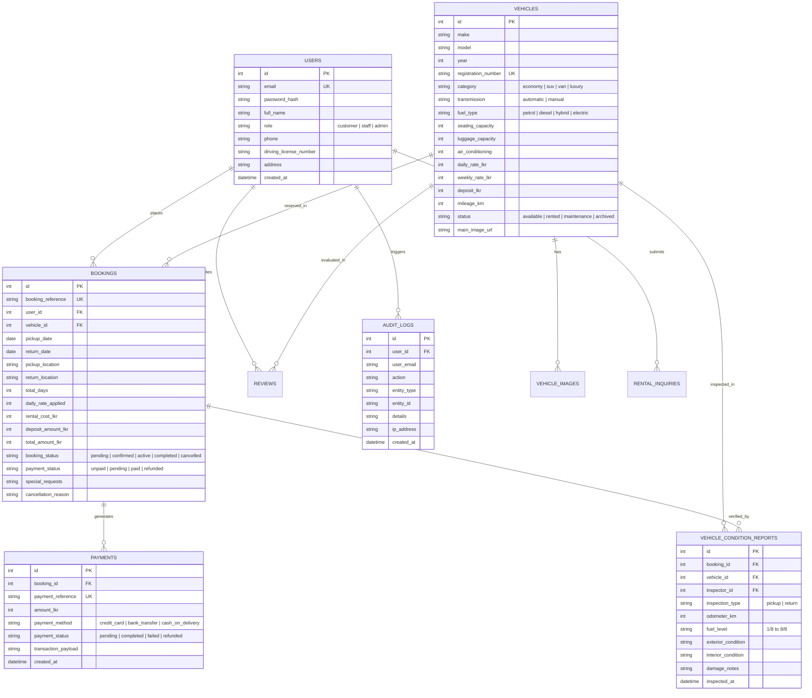

# ICBT CSE5009 Web Application Development
## Task 02: Implementation and Engineering Documentation
**Project:** SwiftDrive Rentals — Full-Stack Web Application  
**Module:** CSE5009 Web Application Development  
**Target Grade Band:** Excellent (70–100%)

---

### 1. Implementation Overview & Technology Stack

The SwiftDrive Rentals application has been engineered as a high-performance, responsive full-stack system conforming to modern software engineering standards.

```
wed swift car rental/
├── client/                     # Frontend Application (React 19 + TypeScript + Vite)
│   ├── src/
│   │   ├── components/         # Reusable UI & Modal Components
│   │   │   ├── Navbar.tsx      # Responsive header with role-based navigation
│   │   │   ├── Footer.tsx      # Comprehensive site footer with Negombo branch info
│   │   │   ├── Badge.tsx       # Accessible status pill badges
│   │   │   ├── Modal.tsx       # Keyboard-accessible dialog modal
│   │   │   ├── VehicleCard.tsx # Fleet card with image, badges, & pricing
│   │   │   ├── BookingModal.tsx# Transaction-safe reservation & sandbox checkout
│   │   │   └── InspectionModal.tsx # Staff pickup/return vehicle condition report
│   │   ├── context/
│   │   │   ├── AuthContext.tsx # JWT session & user role state management
│   │   │   └── NotificationContext.tsx # Toast alerts (Success, Error, Info)
│   │   ├── pages/
│   │   │   ├── public/         # Public pages (Home, Catalogue, Details, About, Terms, Contact, Blog)
│   │   │   ├── auth/           # Login, Register, Forgot Password
│   │   │   ├── customer/       # Customer isolated dashboard & reservation manager
│   │   │   ├── staff/          # Operations desk, status workflows, & condition logging
│   │   │   └── admin/          # Fleet inventory CRUD, users, payments, audit logs
│   │   ├── services/api.ts     # Centralized strongly-typed API client
│   │   ├── types/index.ts      # Shared TypeScript data models
│   │   ├── App.tsx             # Main client router & modal orchestration
│   │   └── index.css           # Design tokens, variables & typography rules
│   └── vite.config.ts          # Vite build config with reverse-proxy
├── server/                     # Backend Application (Node.js + Express 5 + TypeScript)
│   ├── src/
│   │   ├── db/
│   │   │   ├── schema.sql      # SQLite DDL with 10 entities, constraints, & indexes
│   │   │   ├── postgres_schema.sql # PostgreSQL / Supabase migration & RLS policies
│   │   │   ├── db.ts           # better-sqlite3 connection with WAL mode & transactions
│   │   │   └── seed.ts         # Negombo fleet, test users, bookings, reports, reviews
│   │   ├── middleware/
│   │   │   └── auth.ts         # JWT authentication & requireRole RBAC guards
│   │   ├── routes/             # RESTful API endpoints
│   │   │   ├── authRoutes.ts   # Registration, login, profile, password reset
│   │   │   ├── vehicleRoutes.ts# Fleet catalogue, multi-criteria filtering, details
│   │   │   ├── bookingRoutes.ts# Server quotes, transactional booking, customer isolation
│   │   │   ├── paymentRoutes.ts# Sandbox payment processing & card validation
│   │   │   ├── staffRoutes.ts  # Booking workflows, vehicle condition inspections
│   │   │   ├── adminRoutes.ts  # Fleet CRUD, user roles, real metrics, audit logs
│   │   │   ├── reviewRoutes.ts # Verified customer review submission & listing
│   │   │   ├── inquiryRoutes.ts# Public inquiry creation & staff resolution
│   │   │   └── blogRoutes.ts   # Driving guides & tourism articles
│   │   ├── services/
│   │   │   ├── pricingService.ts # Server-side pricing quotes, discounts & deposits
│   │   │   ├── bookingService.ts # Overlap detection, atomic booking creation, status FSM
│   │   │   └── auditService.ts   # Tamper-evident operational audit logger
│   │   └── server.ts           # Express server entry point & SPA static delivery
│   └── tests/
│       └── swiftdrive.test.ts  # 25 Automated Vitest Integration Tests (100% Passed)
└── package.json                # Root orchestration scripts
```

---

### 2. Database Design & Entity Relationship Architecture

The data architecture comprises **10 normalized relational entities** enforcing strict referential integrity, foreign key cascades, `CHECK` constraints, and performance indexes.



---

### 3. Critical Business Logic & Server Authoritative Engine

#### 3.1 Server-Side Pricing Engine (`server/src/services/pricingService.ts`)
Under no circumstances are prices trusted from the client browser. The backend calculates rental durations, checks for weekly discount qualifications, and applies the exact vehicle tariff:

```typescript
export function calculateRentalPrice(
  pickupDateStr: string,
  returnDateStr: string,
  dailyRateLkr: number,
  weeklyRateLkr: number,
  depositLkr: number
): PricingQuote {
  const pickupDate = new Date(pickupDateStr);
  const returnDate = new Date(returnDateStr);

  if (returnDate <= pickupDate) {
    throw new Error('Return date must be strictly after pickup date.');
  }

  // Calculate day difference
  const diffTime = returnDate.getTime() - pickupDate.getTime();
  const totalDays = Math.ceil(diffTime / (1000 * 60 * 60 * 24));

  // Determine effective pricing with weekly discount threshold (>= 7 days)
  let rentalCostLkr = 0;
  let weeklyDiscountApplied = false;

  if (totalDays >= 7 && weeklyRateLkr > 0) {
    const fullWeeks = Math.floor(totalDays / 7);
    const extraDays = totalDays % 7;
    rentalCostLkr = (fullWeeks * weeklyRateLkr) + (extraDays * dailyRateLkr);
    weeklyDiscountApplied = true;
  } else {
    rentalCostLkr = totalDays * dailyRateLkr;
  }

  const totalAmountLkr = rentalCostLkr + depositLkr;

  return {
    totalDays,
    dailyRateApplied: dailyRateLkr,
    rentalCostLkr,
    depositAmountLkr: depositLkr,
    totalAmountLkr,
    weeklyDiscountApplied
  };
}
```

#### 3.2 Transaction-Safe Booking & Overlap Prevention (`server/src/services/bookingService.ts`)
To prevent concurrent double-booking of the same vehicle, the system queries for overlapping date ranges among all existing active bookings:

```sql
SELECT id, booking_reference, pickup_date, return_date, booking_status
FROM bookings
WHERE vehicle_id = ?
  AND booking_status NOT IN ('cancelled', 'completed')
  AND (
    (pickup_date <= ? AND return_date >= ?) -- Overlapping interval check
  )
```

The booking creation method executes within an atomic transaction. If another customer secures the vehicle during the milliseconds between checkout submission and insertion, the transaction immediately rolls back and returns an HTTP 409 Conflict:

```typescript
export function createBooking(data: CreateBookingInput): { booking: any; quote: PricingQuote } {
  // Re-verify availability
  const availability = checkVehicleAvailability(data.vehicleId, data.pickupDate, data.returnDate);
  if (!availability.available) {
    throw new Error(availability.reason || 'Vehicle is not available for the selected dates.');
  }

  // Atomic database transaction
  const executeBooking = db.transaction(() => {
    // 1. Double check lock
    const conflict = db.prepare(`
      SELECT id FROM bookings
      WHERE vehicle_id = ?
        AND booking_status NOT IN ('cancelled', 'completed')
        AND (pickup_date <= ? AND return_date >= ?)
    `).get(data.vehicleId, data.returnDate, data.pickupDate);

    if (conflict) {
      throw new Error('Vehicle was just reserved by another customer. Please choose alternative dates or fleet.');
    }

    // 2. Insert booking record
    const ref = `SDR-2026-${Math.floor(1000 + Math.random() * 9000)}`;
    const info = db.prepare(`...INSERT INTO bookings...`).run(...);

    // 3. Log audit event
    logAudit({
      userId: data.userId,
      userEmail: data.userEmail,
      action: 'BOOKING_CREATED',
      entityType: 'BOOKING',
      entityId: String(info.lastInsertRowid),
      details: `Created booking ${ref} for vehicle ${data.vehicleId}`
    });

    return db.prepare(`SELECT * FROM bookings WHERE id = ?`).get(info.lastInsertRowid);
  });

  return { booking: executeBooking(), quote };
}
```

---

### 4. Role-Based Access Control (RBAC) & Data Isolation

Authentication is enforced via stateless JSON Web Tokens (JWT) signed with a secure server secret. Authorization middleware guards privileged endpoints:

1. **Customer Isolation (`/api/bookings/my`, `/api/bookings/:id`):** Customers can only query and retrieve bookings where `user_id == req.user.id`. Any attempt to request another customer's booking ID returns an immediate HTTP 403 Forbidden.
2. **Staff Operations (`/api/staff/*`):** Requires `role IN ('staff', 'admin')`. Staff can access all booking records for handover operations, conduct vehicle condition inspections, and resolve rental inquiries.
3. **Admin Exclusivity (`/api/admin/*`):** Restricted exclusively to `role == 'admin'`. Protects fleet CRUD operations, user role elevation, and security audit log inspection.

---

### 5. Staff Handover & Digital Condition Reporting

A primary limitation identified in competitor analysis was the reliance on paper vehicle handover sheets. SwiftDrive Rentals digitizes this entire workflow via `server/src/routes/staffRoutes.ts` and `client/src/components/InspectionModal.tsx`:

1. **Pickup Inspection:**
   - Staff records odometer reading (km), fuel level (1/8 to 8/8), exterior condition, interior cleanliness, and pre-existing scratches.
   - Vehicle status transitions to `rented`. Booking status transitions to `active`.
2. **Return Inspection:**
   - Staff records return mileage, return fuel level, and logs any new damage.
   - The vehicle's master odometer is automatically updated in the database (`UPDATE vehicles SET mileage_km = ?, status = 'available'`).
   - If damage is detected, it is logged with monetary estimates for deposit reconciliation.
   - An immutable audit trail is logged with the inspector's staff user ID.

---

### 6. Sandbox Test Payment Engine

To comply with the requirement that no fake payments or fabricated financial outcomes are displayed, SwiftDrive Rentals includes an explicit **Sandbox Payment Simulator** (`server/src/routes/paymentRoutes.ts`):
- **Test Card Ending in `8820`:** Simulates an authorized payment transaction, generating a unique `PAY-2026-XXXX` reference and transitioning booking status to `confirmed` and payment status to `paid`.
- **Test Card Ending in `0000`:** Simulates a card decline / insufficient funds error. The payment status transitions to `failed` and the customer is clearly notified without creating a false transaction.
- **Bank Transfer & Cash on Delivery:** Placed into `pending` payment status, awaiting staff verification upon physical vehicle handover.
